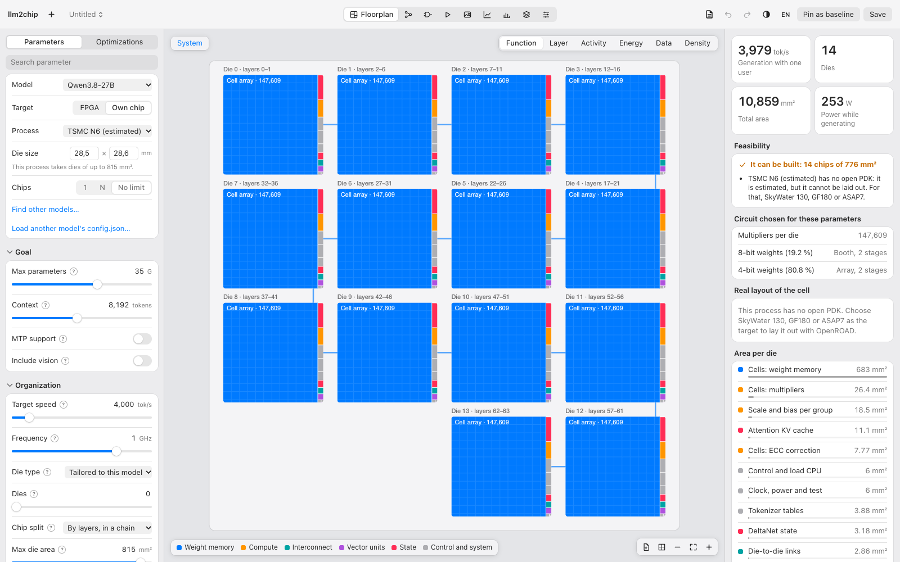
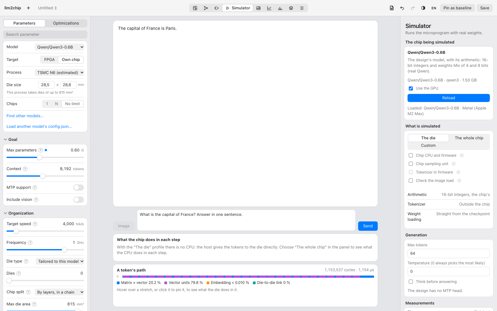
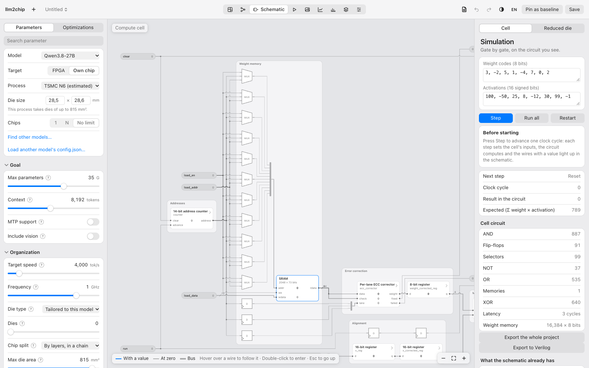
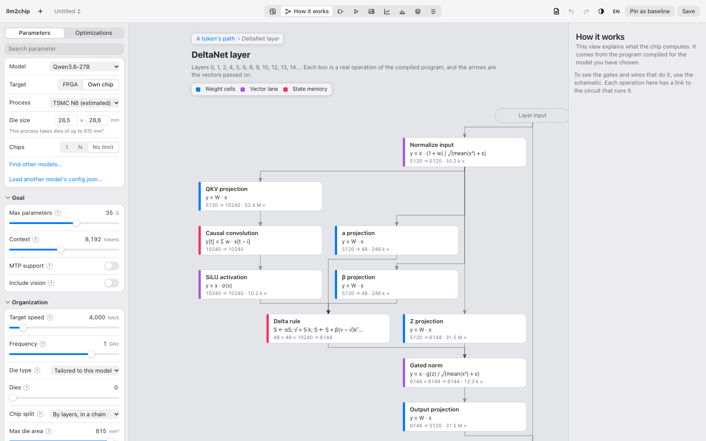
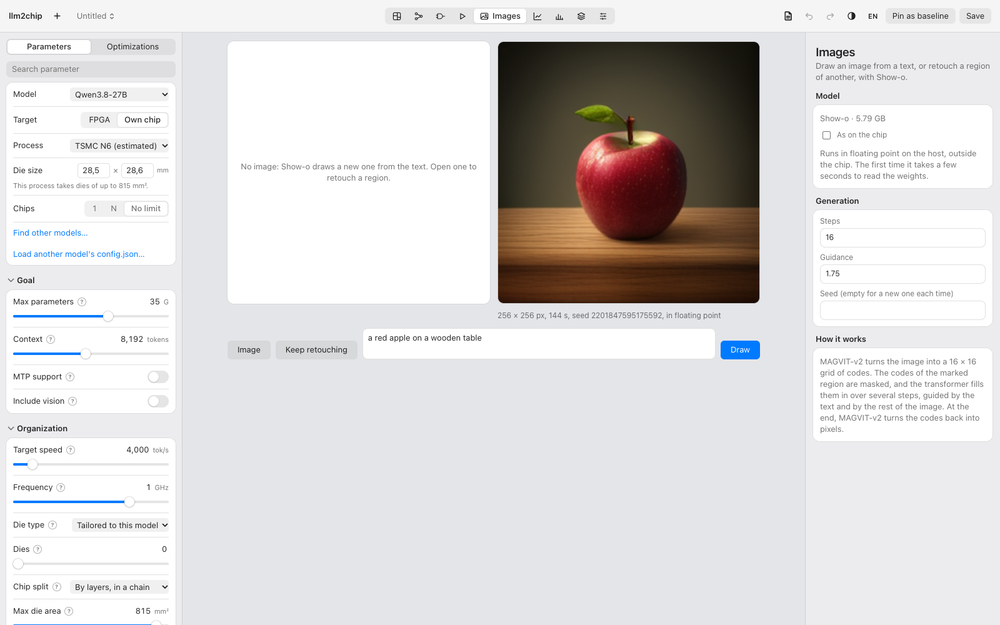

# llm2chip

**Give llm2chip a language model and a set of goals, and it generates the circuit of a chip built for that model.** You can look at the circuit, change its parameters, run the model on it with the chip's own arithmetic, and export it to Verilog and VHDL.

The idea is to take specialization all the way: instead of a general accelerator that streams weights from external memory, every multiplier sits next to the weights it uses, and the whole chip is sized for one model, or one family of models.



> **Status.** llm2chip is a research project. Everything below runs in simulation: the generated netlists are simulated gate by gate and checked against the software models, but nothing has been built on an FPGA board or in silicon yet. Area, power and cost figures for modern nodes are estimates. See [What is verified](#what-is-verified) and [Limits](#limits).

## Try it online

**[alvarograciagil.github.io/llm2chip](https://alvarograciagil.github.io/llm2chip/)** runs in the browser, with nothing to install: size a chip for a model, look at its floorplan, follow a token through it, simulate its circuit gate by gate, and run small models on its arithmetic. Some places to start:

- [Run a model on the chip](https://alvarograciagil.github.io/llm2chip/#simulator): stories260K, generated token by token with the chip's integer arithmetic.
- [The schematic, simulated gate by gate](https://alvarograciagil.github.io/llm2chip/#schematic).
- [How it works](https://alvarograciagil.github.io/llm2chip/#logic): a token's way through the chip.
- [The explorer](https://alvarograciagil.github.io/llm2chip/#explorer): what each weight format costs in area, speed and power.

Larger models, images, the optimiser, the 3D view of the chip at work and the rest need the application on your computer: in the demo those views show captures of what they look like. See [Installing](docs/install.md).

## What it is for

- **Exploring LLM chip design without writing RTL:** how much area, energy, power and speed each decision costs for a given model.
- **Comparing architecture choices with numbers:** weight format, SRAM, ROM or stacked DRAM, number of multipliers, pipeline stages, identical or custom chips, splitting a model across chips by layer or by tensor.
- **Measuring what happens to a real model** with the chip's arithmetic: real weights run on the exact integers the silicon would use, compared against floating point.
- **Understanding how such a chip works inside,** from the model's layers down to each logic gate.
- **A starting point in RTL** for synthesis, FPGA prototyping or research.

## How it works

```
config.json + weights          parameters and goals
        │                             │
        ▼                             ▼
   model graph ───────────────► circuit generator
                                      │  builds and measures each variant
                                      ▼
              ┌──────────────┬────────┴───────┬──────────────┐
              ▼              ▼                ▼              ▼
         floorplan and   microprogram     gate-level      Verilog
          estimates      and firmware      netlist        and VHDL
                             │                │
                             ▼                ▼
                     simulation with     gate-by-gate
                      real weights        simulation
```

What the schematic view draws is the same netlist that is simulated and exported: there are no decorative blocks.

**The circuit follows the parameters.** For each combination, the generator builds every possible form of the compute cell in gates, measures its area, switching activity and critical path, and keeps the best one that meets the requested clock. Given a target speed, the number of multipliers follows from the size of the model.

**One model or many.** Each die can be generated for one specific model, for maximum efficiency, or a single die can be repeated and connected to run larger models, up to limits on layers, width and vocabulary. The number of layers is not fixed: it comes from each model's `config.json`.

## What the chip contains

| Part | Role |
|---|---|
| Compute cells | Weight memory next to its multiplier, with ECC or in ROM; weights stored as narrow codes with a scale and bias per group |
| Activation network | Sends each vector to the cells and gathers the sums |
| Vector and function units | Attention, the DeltaNet delta rule, SiLU, sigmoid, exponential, normalization |
| Sequencer | One fixed microprogram, with loops and parameters, for every token |
| RV32IM CPU | Real firmware written in Rust: boot, tokenizer, control and sampling loops |
| Load controller | Brings the image into every memory and checks its CRC |
| Sampling unit | Top-k and temperature, with a parallel logit filter |
| Chip-to-chip links | Data and commands with error correction and flow control |
| Reliability and debug | Memory self-test, spare rows, JTAG, scan chains and ATPG patterns, counters and a debug port |

A chip can carry a fixed system prompt in its image, and it holds a conversation: each question goes on over the cache the earlier ones left, until a clear pin empties it without reloading the weights ([full chip](docs/full-chip.md#a-conversation-and-the-clear-pin)).

All the chips in a system come from the same netlist and read the same image. One pin decides which one leads; at boot they count themselves along the control chain, and each one takes its part of the model.

## The application

A web interface backed by a local engine (or a desktop app):

- **Floorplan:** the chip's areas, zooming from the whole system down to a cell.
- **How it works:** the operations the model performs, layer by layer, and where each one runs.
- **Schematic:** the real circuit by area, down to each logic gate, simulated step by step.
- **Simulator:** type a prompt and run it on the chip, choosing how much of each block to simulate. Questions follow one another as a conversation over the chip's cache, with how much of its context they take; a new conversation raises the chip's clear pin.
- **Images:** draw a picture from a text, or retouch a marked region of one, with Show-o, optionally exactly as the chip would (its cells, its addressing and its firmware's sampling loop). Janus-Pro draws from the Simulator view. Shown when the project draws images, an option that counts the drawing die in the floorplan.
- **Listen and Speak:** a spoken question heard, answered and said aloud, or a text said, each stage in the chip's arithmetic, and the dies a chip that listens or speaks needs. Shown when the project listens or speaks.
- **Explorer:** parameter sweeps, the Pareto frontier, format comparisons and calibration.
- **Optimise:** say what matters most (speed, silicon, silicon per tok/s or energy per token) and the limits a design must meet, and the engine searches numbers of chips, ways of sharing (including the group size), units, lanes and cells, measuring each on its generated circuit, then recommends one with its alternatives and applies it to the designer.
- **Numerics:** the chip's arithmetic against floating point, layer by layer and token by token.
- **Models:** folders to search, search and download from Hugging Face, and building the chip's full image.
- **New project assistant:** start from an FPGA board, a single chip, a base model or a fully custom design, and optionally go on to the automatic optimisation.

The interface is in English, with a full Spanish translation; a test fails if a text on screen has no Spanish.

| | |
|---|---|
|  |  |
| **Simulator:** Qwen3-0.6B answering with the chip's integer arithmetic | **Schematic:** a compute cell, simulated gate by gate |
|  |  |
| **How it works:** the operations of a DeltaNet layer | **Images:** Show-o drawing from a text |

More in the [walk through the application](docs/examples.md#the-application).

### Supported models

| Level | Architectures | What you can do |
|---|---|---|
| Runs | Qwen3.5 (dense and MoE), Llama (including Llama 3 RoPE), Mistral, Qwen2, Qwen3, Gemma 1, 2 and 3, DeepSeek V3 and R1 | Design their chip and run their real weights |
| Images | Show-o (with MAGVIT-v2), Janus-Pro, the Qwen3.5 vision encoder | Run them in the chip's arithmetic |
| Voice | Moonshine and streaming Moonshine (speech to text), OuteTTS-1.0 with the DAC.speech decoder (text to speech) | Two optional parts, each off unless the project asks for it: run them in the chip's arithmetic and plan a chip that listens, speaks or both ([voice](docs/voice.md)) |
| Approximate design | Phi-3, Granite | Estimate their chip from the shape of their layers; their activation and extra norms are not modelled |

A `config.json` is enough to design a chip, so a model on Hugging Face can be evaluated without downloading its weights. If a model needs something the chip lacks, the application says what. The firmware tokenizes with each model's own rules; Unigram and WordPiece models and the Precompiled, BERT and NMT normalizers are not supported, as the usual generation models do not use them.

Downloads take only safetensors and metadata, never pickle files or code from the repository. They are pinned to a revision, resume when interrupted, and check every weight file against its SHA-256. Gated models need their license accepted on Hugging Face and a read token, taken from `HF_TOKEN`, from `huggingface-cli` or from the application, and stored only on your machine.

### How much to simulate

| Profile | Inference core | Rest of the chip | Use |
|---|---|---|---|
| Fast | Floating point, on the GPU | Software | Trying models and formats |
| Real arithmetic | Exact integers, on the GPU | Software | Measuring the quality of a design |
| Real flow | Exact integers, on the GPU | Real firmware, sampling unit and image checks | Seeing the whole chip at work |

Acceleration uses Metal on macOS and Vulkan on Windows and Linux. Full gate-by-gate simulation is reserved for tiny models.

## Getting started

To look around first, the [online demo](https://alvarograciagil.github.io/llm2chip/) needs nothing installed. To run it on your computer:

You need Rust with the `wasm32-unknown-unknown` target, `wasm-pack` and Node 22.12 or newer. A Metal or Vulkan GPU speeds up the simulation; Docker, Icarus Verilog and OSS CAD Suite are optional. The [installation guide](docs/install.md) has the steps for macOS, Linux and Windows, every start-up option and the troubleshooting.

```bash
git clone https://github.com/alvarograciagil/llm2chip.git
cd llm2chip
npm --prefix web ci
scripts/dev.sh
```

Then open `http://localhost:5173`. On Windows, `scripts\dev.ps1`. Weights are not included: download a model from the Models view (for example `Qwen/Qwen3-0.6B`), or point it at the folders where you keep yours.

The most used options:

| Option | What it does |
|---|---|
| `scripts/dev.sh --lan` | Opens the interface to your local network, behind an access key. |
| `LLM2CHIP_MODEL_DIRS=~/models:/data/llm` | Extra folders to search for models. |
| `LLM2CHIP_ENGINE_PORT`, `LLM2CHIP_WEB_PORT` | The engine's port (7878) and the interface's (5173). |
| `HF_TOKEN` | Hugging Face token, for gated models. |
| `scripts/build-app.sh` | Builds the desktop application. |
| `scripts/check.sh` | The quick tests; `--full` adds the whole chips in gates and the slow tests. |

## What is verified

- **Whole chip in gates.** The netlist of a complete chip (CPU, firmware, load controller, die and sampling unit) produces the same bytes in the same cycles as the instruction-level simulation, from input to output, on a tiny Qwen3.5 model. So does a toy Show-o chip filling in an image: 12.45 million cycles.
- **Several chips.** With one image, two identical chips on a simulated board, with delays and flipped bits on their links, generate the same text and logits as a single chip, split by layers, by rows or both.
- **Exact arithmetic.** The exact integer machine matches the gates bit for bit in every buffer of those models; the cells and vector lanes give the same bits in gates as in the exact machine.
- **Real models.** Real Qwen3.8-27B runs end to end with the chip's firmware. Real Qwen3-0.6B matches `mlx-lm` in floating point: 24 of 24 tokens. Every supported architecture, with tiny random weights, gives the same logits as `mlx-lm`, token by token.
- **Tokenizer.** The firmware's tokenizer is compiled from each model's `tokenizer.json` and matches the reference library on thousands of difficult texts, including the real files of Llama 3.2, Mistral 7B, Mistral Nemo and DeepSeek V3.
- **Images.** The real Show-o runs on the die as the chip addresses it, with its weights in 8-bit cells: in one pass, 61 of 64 masked places get the same best code as floating point. MAGVIT-v2 runs in the chip's arithmetic with 49.6 dB PSNR (decoder) and 99.3 % of bits equal (encoder).
- **Voice.** Moonshine, streaming Moonshine and OuteTTS with DAC match Transformers on their real weights, and in the chip's arithmetic a spoken question is heard and answered aloud. Toy versions of all three run in gates bit for bit, Moonshine's whole chip included: its firmware orders the die's routines through a command queue, the same bytes in the same 1.19 million cycles as the instruction level ([voice](docs/voice.md)).
- **Conversation.** A chip that holds a conversation answers a second question as one question with the whole conversation would, and its clear pin zeros its cache and recurrent state. This holds at instruction level, in gates on a whole chip, and in gates on two chained chips, where only the leader's pin is wired. The simulator's engine, the real firmware and the browser keep the same cache and give the same answers.
- **Formats and export.** Every weight format and multiplier is checked against reference arithmetic, and the exported Verilog and VHDL run in external simulators.
- **Physical design.** The compute cell and a tile with a real SRAM macro go through OpenROAD on open PDKs, which calibrates the estimator; the FPGA version of the chip is synthesized with Yosys and placed and routed with nextpnr at 35.4 MHz on an ECP5.

Details and measurements are in [`docs/`](docs) and [`tests/golden/`](tests/golden).

## Results at a glance

From [`docs/benchmarks.md`](docs/benchmarks.md), where each figure says whether it was measured or estimated:

- **Qwen3.8-27B, default design (estimated):** 13 dies of 806 mm² in TSMC N6, 1.77 million weight multipliers, about 3,750 tok/s for one user at 240 W. Weight memory is 89 % of the silicon. Counted on the real microprogram with an 8,192-token context full, a token takes 534,000 cycles: about 1,870 tok/s at 1 GHz. Sized from the generated circuit so every die fits the reticle, it reaches about 3,220 tok/s on 12 dies today, in groups of four that share each layer, and about 4,050 on 16 dies in groups of eight ([why](docs/benchmarks.md#dies-sized-from-the-circuit)).
- **Quality on the real weights (measured):** the chip's 16-bit block floating point picks the same token as floating point in 29 of 30 steps on Qwen3.8-27B and 11 of 12 on Qwen3.6-35B-A3B. DeltaNet's state holds at 16 and even 12 bits; plain fixed point does not.
- **Images (measured):** Qwen3.8-27B's vision encoder runs in the die's arithmetic within 1.5 % of floating point; Show-o on 8-bit cells picks the same code as floating point in 61 of 64 places; MAGVIT-v2 decodes at 49.6 dB PSNR from floating point.
- **A chip that listens and speaks (estimated from the circuit):** Moonshine-tiny, Qwen3-0.6B, OuteTTS and DAC on three dies and 591 mm² in N6, the first sound 474 ms after a three-second question ends, about 7 J a turn, most of it leakage; with Qwen3.8-27B, 14 dies and 7,741 mm² ([voice](docs/voice.md#the-system-planned)).
- **FPGA (measured in synthesis):** the smallest complete chip takes 11,166 LUT6 on Xilinx 7 series or 17,872 LUT4 on ECP5, and routes at 35.4 MHz on an ECP5-85F.

## Limits

This is an architecture and logic design, not a manufacturable layout: there is no full-chip place and route, timing sign-off or commercial PDK. In particular:

- **Area, energy and speed are estimates,** partly derived from the generated circuit and partly calibrated against published chips and OpenROAD runs. The application shows where each figure comes from.
- **Real models are not simulated gate by gate,** but with an exact machine that is verified against the gates on tiny models.
- **Multi-chip speeds leave out the links' latency:** cycles are counted from each chip's microprogram, and in gates each single word taken from a link waits about a cycle more, about 1 to 3 % on Qwen3.8-27B ([benchmarks](docs/benchmarks.md#dies-sized-from-the-circuit)).
- **The circuit-sized dies are slower than the estimate:** on Qwen3.8-27B the dies that fit the reticle reach about 3,220 tok/s on 12 dies instead of the estimated 3,750 on 13, mostly because attention at full context takes about a quarter of their cycles ([benchmarks](docs/benchmarks.md#dies-sized-from-the-circuit)).
- **Dies with fewer vector units than heads** take the heads in rounds: the program repeats each loop over heads once a round, and each unit keeps a copy of its heads' cache for every round. Folding the layers into one loop, which would shrink the program to one layer's and matter on FPGAs, is still to be done ([full chip](docs/full-chip.md#a-fixed-microprogram)).
- **Manufacturing tests are not complete:** there are memory self-test, JTAG, scan chains in the chip for manufacturing and ATPG patterns per block with their STIL files, but no patterns for the whole chip's main chain, the chains have pins of their own rather than the JTAG port, and there are no at-speed delay faults.
- **The voice chips are joined by the host in the simulation:** each runs by itself on its firmware, but the four have not been chained pin to pin, and a die that speaks needs 20-bit vectors ([voice](docs/voice.md#limits-and-what-is-next)).
- **A full context is not forgotten little by little:** the chip stops taking tokens until its clear pin, and the host can go on by sending the latest turns, or a summary, again ([full chip](docs/full-chip.md#a-conversation-and-the-clear-pin)).
- **Nothing has run on physical hardware.** The FPGA flow, board recommendations and the expected speed are in [`docs/fpga.md`](docs/fpga.md).
- **The Windows and Linux packages and the Vulkan backend** have not been run on those systems yet.

## Documentation

| Document | Contents |
|---|---|
| [`docs/install.md`](docs/install.md) | Installation on macOS, Linux and Windows, starting, start-up options and troubleshooting |
| [`docs/benchmarks.md`](docs/benchmarks.md) | Results: Qwen3.8-27B on a chip, quality of the chip's arithmetic, images, FPGA and layouts |
| [`docs/examples.md`](docs/examples.md) | Every example and how to run it, and a walk through the application |
| [`docs/simulation.md`](docs/simulation.md) | How the simulation works: floating point, the exact machine, instruction level and gates, and how each checks the next |
| [`docs/full-chip.md`](docs/full-chip.md) | The whole chip: blocks, simulation levels, several chips, the system prompt, conversations and the clear pin, the fixed microprogram |
| [`docs/parameters.md`](docs/parameters.md) | Every parameter of the design, as the application explains it |
| [`docs/vision.md`](docs/vision.md) | Images on the chip: the vision encoder, Janus-Pro and Show-o |
| [`docs/voice.md`](docs/voice.md) | Voice on the chip: speech to text (Moonshine, also while it is spoken), text to speech (OuteTTS and DAC), the firmware's schedules and command queue, and several programs on several dies |
| [`docs/fpga.md`](docs/fpga.md) | Taking the chip to an FPGA: synthesis, boards, expected speed |
| [`docs/asic.md`](docs/asic.md) | Layout with OpenROAD and calibration of the estimator |
| [`docs/manufacturing.md`](docs/manufacturing.md) | What is verified, board rules, scan and ATPG, what manufacturing still needs |
| [`docs/research.md`](docs/research.md) | Published LLM chips used as references |

## Repository layout

| Folder | Contents |
|---|---|
| `crates/model-ir` | Hardware-independent model, from `config.json` |
| `crates/arch` | Parameters, technology, estimator and floorplan |
| `crates/compiler` | The model's program and schedule |
| `crates/netlist` | Circuit generator, gate simulator, Verilog and VHDL, scan and ATPG |
| `crates/sim` | Running real weights, the exact machine, the GPU, image models |
| `crates/maskgit-rt`, `crates/tokenizer-rt` | Code shared by the firmware and the host |
| `crates/server` | Local engine |
| `crates/wasm` | Bindings for the browser |
| `firmware` | Firmware of the chip's CPU |
| `web` | Interface |
| `app` | Desktop application |
| `tech`, `models`, `presets` | Technology nodes, model descriptions and starting designs |
| `tools` | Python reference, model conversion, synthesis and OpenROAD scripts |

## Contributing

Issues and pull requests are welcome. [CONTRIBUTING.md](CONTRIBUTING.md) explains how to check a change and the license under which contributions are accepted.

## License

llm2chip is released under the [PolyForm Noncommercial License 1.0.0](LICENSE.md): you may use, modify and share it for any noncommercial purpose, including personal projects, research and education. Commercial use is not permitted under this license; for commercial licensing, open an issue to get in touch.

Required Notice: Copyright 2026 Álvaro Graciá Gil (https://github.com/alvarograciagil/llm2chip)
