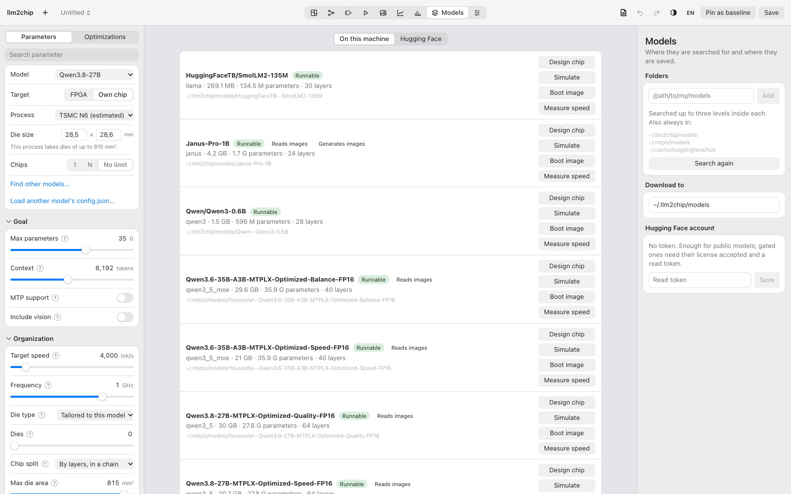
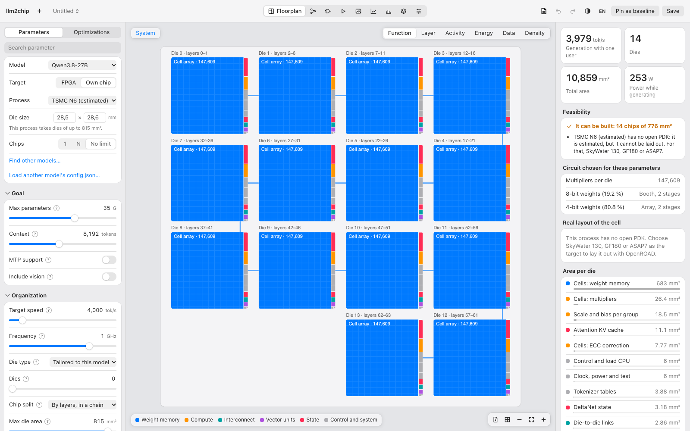
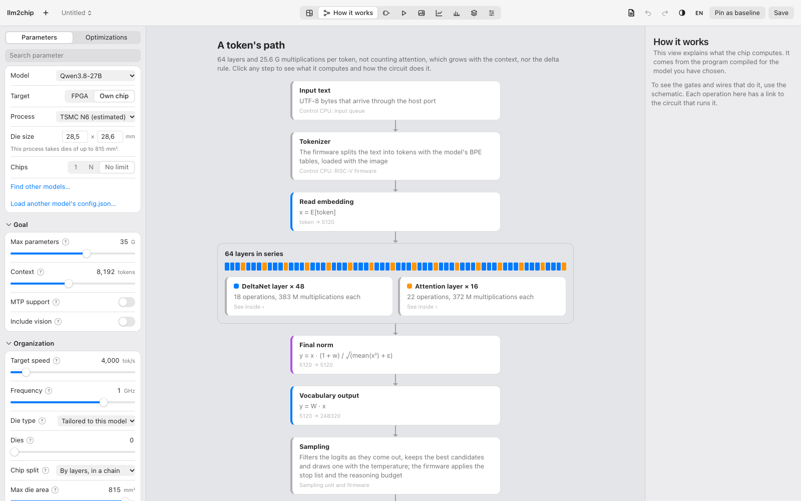
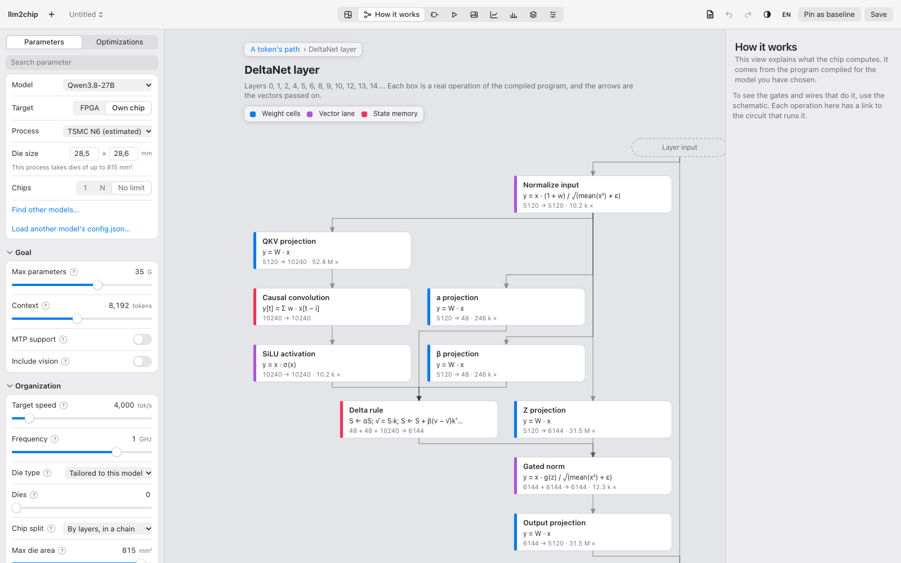
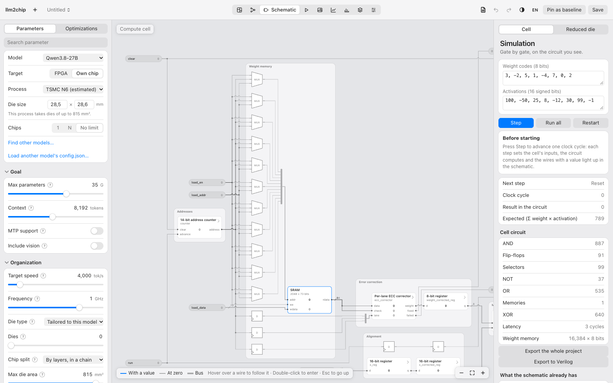
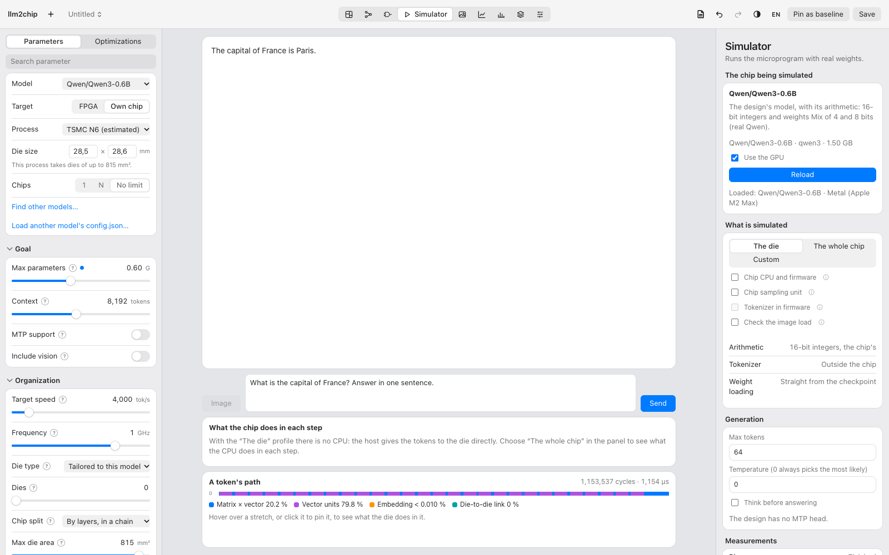
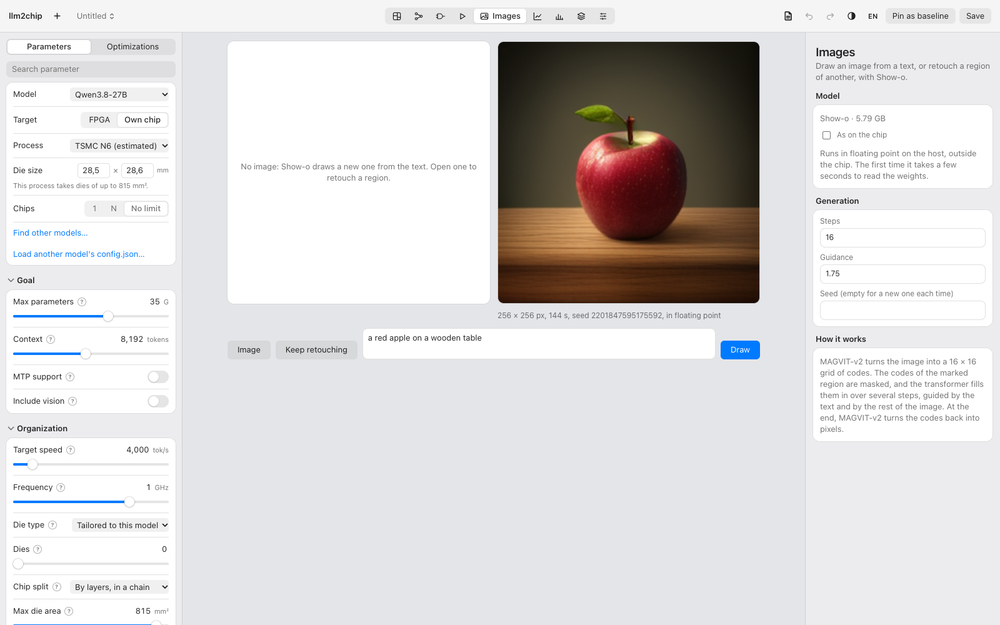
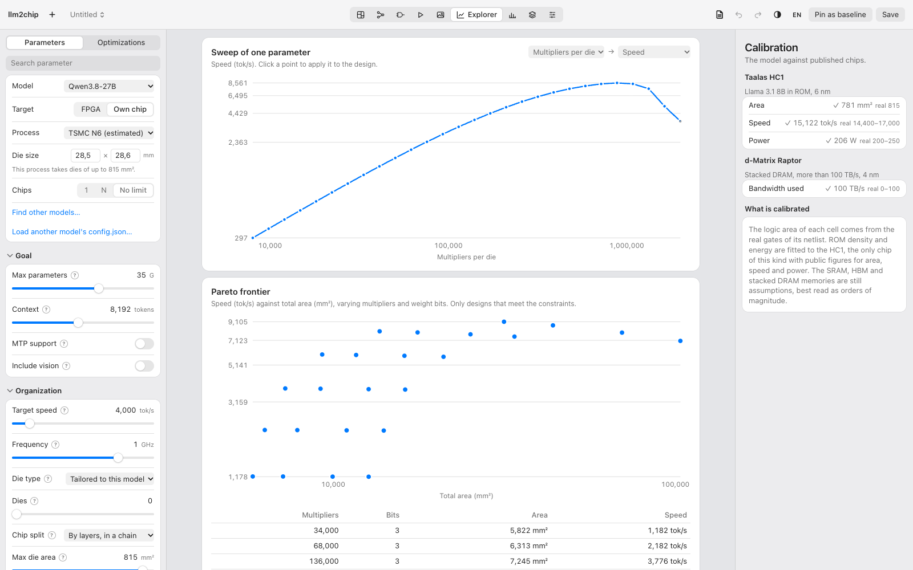
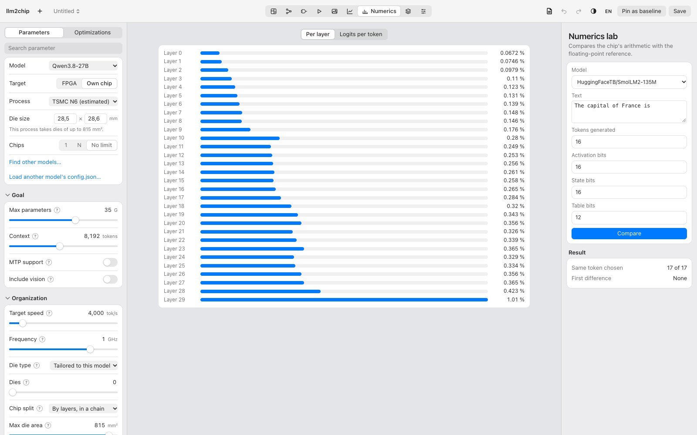

# Examples

Every measurement in [benchmarks.md](benchmarks.md) comes from one of these commands. They run from the repository root; `<folder>` is a model folder in Hugging Face or MLX layout (safetensors, `config.json`, `tokenizer.json`). Weights are not included in the repository.

Add `--release` to every `cargo run` that touches real weights: debug builds are tens of times slower.

## Designing a chip

**Estimate a design.** The analytic estimator: area by block, speed, energy, power, state memory, and whether the design can be manufactured on its process, with checked fixes if not.

```bash
cargo run --release -p arch --example report -- models/qwen3.8-27b.json
cargo run --release -p arch --example report -- models/llama-3.1-8b.json '{"node": "sky130"}'
```

The second argument patches any field of `ChipParams` (see [parameters.md](parameters.md)). A `config.json` is enough; no weights are read.

**Size a chip from the circuit.** Searches die shapes (cells, lanes, vector units, number of chips), generates each one's real microprogram, follows it to the last position of the context and keeps the smallest logic that gives the requested speed and time to first token.

**Optimise automatically.** Says what to make best (`speed`, `area`, `efficiency` for the least silicon per tok/s, or `energy` per token) and the limits every design must meet; the search measures designs on their own circuits and prints the recommended one, its alternatives and the frontier of what it measured. The estimator first rules out numbers of chips whose dies cannot hold the model; each way of sharing that is left (layers, rows, groups of every size that divides the chips) gets the number of cells that suits the goal; the most promising then climb through the number of units, and every width of lane with `--thorough`. Measurements are kept in `~/.llm2chip/cache`, so asking again with another goal or other limits only measures what is new. The Optimise view of the application runs the same search. Energy and power are the estimator's at the measured speed; everything else is measured.

```bash
cargo run --release -p sim --example optimize -- <folder> --goal speed --max-chips 16
cargo run --release -p sim --example optimize -- <folder> --goal area --min-tok-s 2000 --max-first-token-ms 200
cargo run --release -p sim --example optimize -- <folder> --goal efficiency --chips 12,16 --sharing mixed:auto --thorough
```

On Qwen3.8-27B, `--goal speed --max-chips 16` measured 68 designs in about 8 minutes on a 12-core machine and found the fastest point of the full frontier then (16 dies in groups of eight, 128 × 128 units, 65,536 cells, about 3,950 tok/s; about 4,050 since), held back by the reticle, with 16 dies of 64 × 128 units as the least silicon per tok/s; the full frontier over the same chips takes about 53 minutes.

```bash
cargo run --release -p sim --example size -- <folder> 500 1000        # 500 tok/s, first token within 1 s
cargo run --release -p sim --example frontier -- <folder>              # speed against logic, and where speed stops paying
cargo run --release -p sim --example kinds -- <folder>                 # where one token's cycles go, operation by operation
cargo run --release -p sim --example memory -- <folder>                # what each chip's memories hold: microcode, and each unit's vector memory by kind
```

**Calibrate against layouts.** Compares the estimator with the OpenROAD layouts in `tests/golden/asic.json` and fits each process's gate delay.

```bash
cargo run -p arch --example calibrate
tools/asic/flow.sh        # needs Docker with OpenROAD-flow-scripts; see asic.md
```

## Running a model

**Generate text in floating point** (the reference, GPU accelerated):

```bash
cargo run --release -p sim --example complete -- <folder> "The capital of France is" 20
```

**Generate with the chip's arithmetic** and compare it with floating point, token by token:

```bash
cargo run --release -p sim --example exact -- <folder> 30
BITS=14 cargo run --release -p sim --example exact -- <folder> 12
```

**Find where the integers drift** from floating point, buffer by buffer:

```bash
cargo run --release -p sim --example compare -- <folder> 8
```

**Measure weight formats** (top-1 agreement and mean KL against floating point):

```bash
cargo run --release -p sim --example formats -- <folder> 64 q8 mlx4 fp8 mxfp4 nvfp4 posit8
```

**Measure fixed-point precision** with teacher forcing (activation, state and function table bits):

```bash
cargo run --release -p sim --example numeric -- <folder> 40
```

**Measure MTP acceptance** (how often the multi-token prediction head guesses the next 1-3 tokens):

```bash
cargo run --release -p sim --example mtp -- <folder> 60
```

**Simulation speed** on the CPU and the GPU, in floating point or (with `BITS`) in the chip's arithmetic:

```bash
cargo run --release -p sim --example speed -- <folder> 8
```

## Images

**Ask a vision model about a picture.** `see` draws a shape (`red` disc, `blue` square, `green` triangle) and asks Qwen3.8-27B about it; with `chip`, the vision encoder and the model run in the die's arithmetic.

```bash
cargo run --release -p sim --example see -- <qwen folder> red "What colour is the shape?" 8
cargo run --release -p sim --example see -- <qwen folder> blue "What shape is this?" 8 chip
cargo run --release -p sim --example see_exact -- <qwen folder> 16      # the encoder alone, chip against floating point
cargo run --release -p sim --example look -- <janus folder> image.bmp "Describe the picture." exact
```

**Draw with Janus-Pro** (with `EXACT=16`, the language model and its image heads in the chip's arithmetic):

```bash
cargo run --release -p sim --example draw -- <janus folder> "a red apple on a wooden table" apple.bmp 1 7
```

**Retouch with Show-o.** The folder holds Show-o, MAGVIT-v2 in `magvitv2` and Phi-1.5's tokenizer in `phi`. `disc` stands for a red disc drawn on white.

```bash
cargo run --release -p sim --example inpaint -- <showo folder> retouch disc 64,64,192,192 "a yellow lemon" lemon.bmp 4 1.75 1
cargo run --release -p sim --example inpaint -- <showo folder> draw "a red apple" apple.bmp
cargo run --release -p sim --example inpaint -- <showo folder> reconstruct photo.bmp same.bmp
```

**Show-o as the chip runs it:** integer MaskGIT on the CPU's code, guidance on the die, 8-bit cells, the embedding table in the image.

```bash
cargo run --release -p sim --example showo_addressed -- <showo folder> 4096 pass     # one pass against floating point
cargo run --release -p sim --example showo_fill_chip -- <showo folder> out.bmp 4 1  # a full retouch
cargo run --release -p sim --example showo_fill_compare -- <showo folder> out/ 1,3,5,7 1 4 "a yellow lemon"
cargo run --release -p sim --example showo_formats -- <showo folder>                # loss by weight format
```

## Voice

The models and how to get them are in [voice.md](voice.md#getting-them): Moonshine-tiny or streaming Moonshine to listen, any language model to answer, OuteTTS-1.0-0.6B to write the speech and DAC.speech, converted with `tools/convert/dac.py`, to make the sound.

**A spoken turn:** a WAV question in, a WAV answer out. With `die 20` every stage runs in the die's arithmetic with 20-bit vectors (about five minutes); `sample SEED` draws the speech as OuteTTS does; `voice` speaks in the profile kept with OuteTTS.

```bash
cargo run --release -p sim --example talk -- <moonshine folder> <language model folder> <outetts folder> <dac folder> question.wav answer.wav die 20
```

**Each stage on its own**, against Transformers when given a reference from `tools/golden/` (see [voice.md](voice.md#references-against-transformers)):

```bash
cargo run --release -p sim --example listen -- <moonshine folder> clip.wav [golden.json] [bits]
cargo run --release -p sim --example speak -- <outetts folder> <dac folder> "Hello, I am a chip." out.wav [golden.json] [die 20] [speaker speakers/en-female-1-neutral.json words 3]
cargo run --release -p sim --example dac_check -- <dac folder> golden.json 20 out.wav
```

`listen` runs a streaming model as its firmware would, listening as the speech comes.

**Plan a chip that listens and speaks:** every way of putting the four stages on dies, the shapes, the first sound and the energy of a turn. The numbers after the folders are the first sound's limit in milliseconds, the longest question in seconds and the tokens of the answer's first sentence; `voice` has the writer read a speaker's profile.

```bash
cargo run --release -p sim --example voice_system -- <moonshine folder> <language model folder> <outetts folder> <dac folder> 500 3 12
```

## Hardware

**Export a compute cell** in Verilog, in any format and multiplier:

```bash
cargo run -p netlist --example export -- affine 4 0 booth > cell.v
```

**The whole chip for an FPGA:** the RISC-V controller, the die with only the logic its microprogram uses, and the sampling unit.

```bash
cargo run --release -p sim --example fpga -- chip.v --dsp
cargo run --release -p sim --example fpga -- chip.v --dsp --model ~/.llm2chip/models/stories260K-q8 --context 64 --cells 8 --lanes 4 --memories
tools/synth/families.sh chip.v       # Yosys for Xilinx, Gowin, ECP5 and Cyclone IV
```

**A board demo:** one compute cell behind a serial port, with its testbench, a Quartus project and a host script.

```bash
cargo run -p netlist --example board -- board/
```

**Factory tests:** scan chains and ATPG patterns with their fault coverage; with `STIL`, each block's test in the format testers read.

```bash
cargo run --release -p netlist --example atpg -- cell cpu sampler
STIL=out cargo run --release -p netlist --example atpg -- cell          # writes out/cell.stil
```

**Critical paths** of dies of several sizes, and gate counts of the cell by part:

```bash
cargo run --release -p sim --example paths
cargo run --release -p sim --example cellge
```

## The application

```bash
scripts/dev.sh
```

Open `http://localhost:5173`:

1. **New project** (the + button): pick an FPGA board, a single chip, a base model or a custom design.
2. **Models:** the checkpoints found on this machine, with what each can do. *Design chip* resizes the chip for one; *Simulate* runs it. The panel on the right sets where models are searched for: the usual places can be turned off and other folders added. (The path under each model is hidden in this screenshot.)

   

3. **Floorplan:** move parameters on the left; areas, dies, speed and power update as you drag. Here, Qwen3.8-27B on 14 dies of TSMC N6 (estimated), with the area of each block on the right.

   

4. **How it works:** a token's path through the chip, and inside each kind of layer the real operations of the compiled program, coloured by where they run.

   
   

5. **Schematic:** open any block down to its gates and step through a simulation with the values on the wires. Here, one compute cell: its weight memory, error correction and multiplier.

   

6. **Simulator:** load the chip and type a prompt. *The die* runs only the die's microprogram; *The whole chip* adds the CPU, firmware and sampling unit, and shows what each did in every step. Below, the cycles of one token across the die. Here, Qwen3-0.6B answering with the chip's 16-bit integer arithmetic on the GPU.

   

7. **Images:** type what to draw, or load a picture and drag over the region to change. *As on the chip* runs it as the chip would. Here, Show-o drawing "a red apple on a wooden table" in floating point (144 s).

   

8. **Explorer:** sweep one parameter and see the Pareto frontier of speed against area, with the calibration against published chips on the right.

   

9. **Numerics:** run a model in floating point and in the chip's arithmetic side by side. Here, SmolLM2-135M at 16 bits: the error per layer grows from 0.07 % to 1 %, and all 17 tokens match.

   

10. **Voice:** record a question with the microphone or open a recording, and hear the chip's answer, every stage in floating point or in the die's arithmetic; the conversation goes on until *New conversation*. The panel plans the chip that would do it: the dies, the time to the first sound and the energy of a turn. The wizard's *A voice assistant* starts there.

The screenshots were taken with the app as it is in the repository, on an Apple M2 Max with 64 GB.
